# Android latency post-mortem — 2026-11-07

**Scope clarification:** the 2–3.8 s transition estimate and 3–4 s proposed target
below concern only a teleport after gameplay is already ready. They exclude
application startup, connection and initial loading. The measured startup-inclusive
process median was 52.57 s. No four-second cold-start claim is supported.

The current implementation has reached a plateau for the mechanisms tested, not
a fundamental speed limit. The next useful change is to reduce the scope of each
observation. Full-screen OCR and full-frame capture remain expensive even when
the next decision depends on a small region. The intermittent 40.98-second
arrival remains a separate, unresolved problem.

This investigation added diagnostic and offline replay tools. It did not change
the runtime, action guards, arrival rules, installed wheel, or OCR thresholds.
One cold and three warm diagnostic tasks passed on phone RFCR91GWXLX. The prior
app was restored. Diagnostic image writes affect timing; these runs are not a
new speed comparison with Airtest.

## What the previous comparison actually established

The [full comparison](android-airtest-current-comparison-2026-11-07.md) found:

| Measurement | TestKit | Airtest | Interpretation |
| --- | ---: | ---: | --- |
| Cold process median | 52.57 s | 57.24 s | Includes startup and setup |
| Fully initialized warm median | 5.18 s | 6.01 s | Original Airtest polling |
| Fully initialized warm median | 5.18 s | 4.81 s | Airtest polling changed to 100 ms |
| Warm fresh-process maximum | 40.98 s | 9.70 s | TestKit has an unresolved tail |

Four samples per cell are too few for population tail estimates. A faster input
path did not guarantee a faster complete task. Airtest's cheap regional template
checks overcame its slower dispatch when its polling interval was matched.

The four initialized TestKit tasks had the following component medians. Component
medians do not necessarily add to the median task time.

| Work on host's serial path | Time | What it includes |
| --- | ---: | --- |
| Capture | 1.438 s | Acquisition, comparison, encoding, transport, decoding |
| OCR | 1.384 s | Full pipeline and result conversion |
| Three guarded taps | 0.686 s | Fresh geometry/overlay/focus checks and input command |
| Remaining time | 1.626 s | About 1.4 s scheduled sleeps, preprocessing, policy, logging, evidence |

All four tasks used 15 captures. Four or five were exact repeats. They made eight
or nine OCR calls. The second arrival confirmation added about 357 ms after the
first accepted world observation. This confirms stability; removing it would
change the completion contract.

## Theoretical shortest time

There is no defensible single absolute minimum from these measurements. The game
is external: animation, loading, network, render scheduling and input acceptance
are not under the controller's control. The bounds also depend on what counts as
completion: visible gameplay, verified HUD, or two observations plus saved evidence.

For the warm task, the dependency chain is:

```mermaid
flowchart LR
    W[Observe world] --> I1[Guard and tap map]
    I1 --> G1[Game opens map]
    G1 --> O1[Observe map]
    O1 --> I2[Guard and select waypoint]
    I2 --> G2[Game reveals panel]
    G2 --> O2[Verify teleport target]
    O2 --> I3[Guard and tap teleport]
    I3 --> G3[Game transition and loading]
    G3 --> O3[Observe arrival twice]
    O3 --> E[Finish evidence]
```



An ideal controller with zero observation and dispatch cost would still wait for
`G1 + G2 + G3`. A real controller adds readiness-detection lag, guarded input,
final verification and any evidence work that remains unfinished. Work done during
a game transition can overlap that wait. Therefore subtracting all OCR, capture
and sleeps from 5.18 s does **not** produce a valid physical lower bound.

The new frame sequences permit broad, conditional bounds for visible transitions:

| Diagnostic warm run | Sum of three visible-transition intervals |
| --- | ---: |
| 01 | 2.04–3.66 s |
| 02 | 2.06–3.82 s |
| 03 | 1.99–3.54 s |

These are sampling brackets, not statistical confidence intervals or measured
ideal-controller runtimes. The last visibly unready image and first visibly ready
image bracket each transition. Acquisition occurred somewhere between capture
request and return; injection occurred somewhere inside the tap call. Bounds use
those enclosing intervals. The selected-panel transition has a zero lower bound
because there is no intermediate sample. Run 01's first visible returned world was
still `unknown` to the HUD rule; its image is used only for post-run evaluation.

Under the assumption that earlier inputs preserve these game-transition durations,
roughly **2–3.8 s is the observed envelope for an ideal visible-state controller**.
It is not a promise that the current verified workflow can reach 2 s. A 3–4 s warm
task is a reasonable next engineering target, not an established result. Startup
is a separate problem: the earlier cold runs reached their first minimap input
around 46 s. Warm-task arithmetic cannot establish a cold-start minimum.

## Waste audit

### Pixels: what is already eliminated

The Android helper captures a fresh bitmap and compares it with the previous
bitmap. An exact repeat sends only a four-byte response on this Windows path.
The host reuses the decoded image; the profile normally reuses its recognition.
Thus unchanged full images are already excluded from JPEG transfer and repeated
OCR. Capturing and comparing them still costs time.

Across the three new warm tasks: 46 captures, 13 exact repeats, 33 fresh images,
5,194,536 transferred bytes. Median fresh capture was 111 ms; repeat capture was
65 ms. Their difference is **not** a measurement of USB transfer alone: encoding,
decoding, comparison and scene conditions also differ.

### Pixels: what remains

* **Full-frame work after small changes.** A 2400×1080 RGBA frame is 10.37 MB
  before compression. Even an irrelevant animation invalidates whole-frame reuse.
  The helper still captures and reads back the full frame before deciding to skip.
* **Text-safe transport overhead.** JPEG is Base64 encoded because this shell path
  translates line endings. Base64 expands payload by roughly one third. A binary
  framed socket would remove roughly one quarter of current wire bytes: about
  0.43 MB per diagnostic warm task. That is not a 25% task-time saving.
* **Uniform backgrounds are already compressed.** A mostly black loading image
  transferred about 25 KB; repeats transferred four bytes. Skipping its black
  area cannot save the same amount as skipping an uncompressed framebuffer.
* **Exact tile deltas have limited benefit on these transitions.** On decoded
  adjacent images, 26 of 33 fresh frames changed every 64×64 tile. Median changed
  tile area was 100%; median changed pixel fraction within each run exceeded 99%.
  Fades, map animation and game rendering change much more than text. These are
  decoded JPEG comparisons, not raw compositor damage measurements. They do not
  prove tile deltas are useless on static apps.

Requesting only the region needed for a decision is more promising here than
requiring the rest of an animated scene to remain byte-identical. Crop at capture
time if possible; cropping after a full GPU readback saves downstream work only.

### OCR: detection is the main repeated search

The installed RapidOCR implementation first detects text. If detection returns no
boxes, it returns before orientation classification and character recognition.
Adding another general text detector would duplicate that work.

Across the new warm traces, 27 OCR calls spent:

| OCR stage | Total | Share of these measured stages |
| --- | ---: | ---: |
| Text detection | 2.245 s | 58.8% |
| Text orientation | 0.292 s | 7.6% |
| Character recognition | 1.283 s | 33.6% |

Recognized text boxes occupied a median **0.88% of the image**. That is accepted
box area, not a ground-truth estimate of all text. The detector still searches
the full image, reduced to the configured maximum side of 1280 pixels.

No traced OCR call had zero detector proposals. One produced no accepted text
after recognition. Most visually empty loading frames still contained a UID;
some proposals were non-text marks. Thus “no accepted text” does not imply no
detector work or no attempted recognition.

The cheap loading check bypasses OCR only until the first loading observation.
It then clears the cached classification. The next observation—even an exact
repeat—runs full OCR once and can cache `unknown`. Four OCR calls across the three
warm tasks still passed the loading-pixel gate; their model stages cost 433 ms in
total. This is a candidate for more selective inspection, not automatically free
waste: skipping dark screens wholesale could hide a network or login dialog.

### A measured candidate: regional HUD OCR

Offline replay compared the same engine on the full frame versus two native-scale
regions: bottom-right UID and bottom-center health/level. Together these cover
about 10.6% of the screen. Both use the existing HUD predicate. Preprocessing is
shared and excluded from the paired recognition timings; image loading and file
hashing are also excluded. One warmup precedes two alternating paired passes.

| Replay, 33 fresh images × two passes | Full screen | Two regions |
| --- | ---: | ---: |
| Median OCR + HUD check | 127.4 ms | 51.6 ms |
| HUD accepted, per pass | 9/33 | 9/33 |
| Per-image decision disagreement | — | 0/33 in each pass |

This is a **59.5% component reduction**, not an E2E improvement. Agreement with the
old predicate is not independent accuracy evidence. These images come from three
nearby runs in one scene. The regional version cannot replace full-screen network,
login, startup and map checks. Keep it experimental until those obligations have
an explicit owner and fresh day/night, overlay and error cases pass.

### Waiting, input and evidence

The normal loop is serial: capture → OCR → decision → tap if needed → sleep.
A 100-ms sleep is only part of readiness lag; a fresh OCR observation can add
another 200–300 ms. Ten-ms polling previously increased work and worsened E2E.
Make observations cheaper before polling faster. Use a bounded latest-frame
pipeline if capture overlaps OCR; never build a queue of stale decisions.

The persistent shell is warm, but each tap still invokes Android's `input`
command and fresh dumpsys guards. A persistent injector could remove repeated
command setup. It must preserve current focus, display and overlay checks,
single dispatch, lost-acknowledgement behavior and cleanup. Reusing old focus
merely to improve a benchmark is not equivalent behavior.

Before/map/selected PNG writes already overlap transitions. Arrival PNG and
pending writes must finish before task completion. Latest-OCR JSON and console
logging remain synchronous; they are smaller candidates and have not been
separately timed. Removing evidence from the measured endpoint would change the
metric rather than demonstrate the same task completing faster.

## The long-tail post-mortem

The original warm outlier took 40.98 s, including 15.91 s capture and 12.65 s OCR
over 108 observations. It sent exactly the expected three inputs. After loading,
it produced a long sequence of fresh `unknown` observations before two world
observations. The cold companion also had a delayed arrival confirmation.

The old harness saved the first loading frame and final arrival, but not the
intervening rejected images. Consequently it cannot distinguish prolonged game
transition from HUD false negatives. The final successful screenshot and a
successful replay of that screenshot cannot answer this question. That missing
evidence was the main investigation failure.

The new probe records every warm observation, its image, OCR lines, stage times,
bytes, repeat flag and action timing. Its warm tasks completed in 5.25, 5.24 and
4.78 s. It did not reproduce the 40.98-second tail. One returned game scene was
visible a sample before the HUD predicate accepted it; the regional OCR replay
did not change that decision. The proposed daylight health-color explanation
therefore remains unproven, and no threshold was relaxed.

## Ranked next experiments

| Priority | Candidate | Smallest useful validation and rejection condition |
| --- | --- | --- |
| 1 | Explain the long tail | Retain timestamped rejected frames in a bounded ring buffer; inspect a reproduced tail. Reject a diagnosis unsupported by those images. |
| 2 | State-specific regional recognition | Use HUD regions for arrival, target/panel regions for map steps, with explicit full-screen error coverage. Compare frozen cases and fresh day/night/dialog holdouts; reject any new missed error or premature action. |
| 3 | Capture-time regions and exact regional cache | Measure readback, JPEG, bytes and OCR separately. Preserve frame IDs, timestamps, geometry and rotation; invalidate on changes and use a fresh full-frame fallback. Reject stale or misregistered crops. |
| 4 | Persistent guarded input helper | First separate guard cost from command startup. Retain guard/lost-ack contracts; require live E2E improvement, not just faster injection. |
| 5 | Binary image transport | Keep acquisition and JPEG quality fixed; compare only framing/transport. Validate truncation, reconnect and rotation. Reject if task latency does not improve enough to justify protocol complexity. |
| 6 | Overlap and adaptive observation | One in-flight capture, bounded latest frame, fresh post-action observations. Reject growing frame age, extra OCR load or worse tails. |

Do not add these hypothetical savings together. Faster recognition changes how
many frames are sampled and how much work overlaps the game's wait. Compare one
change at a time, then run a fresh E2E holdout with the same completion contract.
Report median, mean, maximum, success and unknown duration; a median win with a
new 40-second tail is not a satisfactory outcome.

## Lessons from primary sources

MaaFramework documents recognition regions and recognition-only OCR when a precise
region is already known. This supports the design direction, not a local speed
claim. Its shortcut assumes reliable region ownership; arbitrary screenshots do
not supply that automatically. [Pipeline protocol](https://github.com/MaaXYZ/MaaFramework/blob/main/docs/en_us/3.1-PipelineProtocol.md)

Android 13 capture arguments support source crops and frame scaling. They offer
a way to reduce the buffer before host transfer. This is a hidden platform path;
the existing helper restricts direct capture to its tested platform and needs
rotation/fallback checks for any extension. [AOSP implementation](https://raw.githubusercontent.com/aosp-mirror/platform_frameworks_base/android13-release/core/java/android/view/SurfaceControl.java)

scrcpy separates video and control sockets and avoids display buffering by default.
The transferable lesson is bounded queues and binary transport. Replacing the
current path wholesale is not justified: earlier local streaming experiments
increased OCR work and lost to the on-demand path. [Architecture](https://github.com/Genymobile/scrcpy/blob/master/doc/develop.md)

Sources checked 2026-11-07. Installed RapidOCR source was inspected locally because
its current online API differs from the installed 1.4.4 implementation.

## Reproduction and evidence

Run with this workspace's `.venv/androidtestkit/Scripts/python.exe`:

```text
benchmarks/android/latency_postmortem_probe.py --serial RFCR91GWXLX --output artifacts/android-latency-postmortem/NEW
benchmarks/android/latency_postmortem_analysis.py artifacts/android-latency-postmortem/NEW
benchmarks/android/latency_roi_replay.py artifacts/android-latency-postmortem/NEW
```

The first command sends the established game-entry/teleport actions. The other two
are offline. Raw evidence remains ignored under
`artifacts/android-latency-postmortem/diagnostic/`: source hashes, complete status,
per-task results, lossless intermediate images, contact sheets, `analysis.json`
and `roi-replay.json`. Earlier timing decomposition is in the sibling
`historical-decomposition.json`. No generated images or telemetry were staged.
