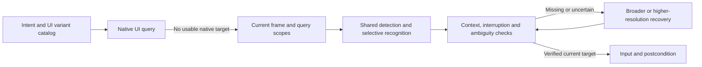

# OCR solution selection for UI automation

The 0.4.0 change accelerated inference. It did not establish a complete solution
for finding and safely acting on changing UI text. This investigation compares
existing systems and tests their query paths, rather than selecting another model.

## Decision contract

**CPU-only is a requirement.** GPU inference and accelerator comparisons are
excluded from further OCR work. The installed OpenVINO adapter explicitly compiles
for CPU; the inspected RapidOCR 3.10 OpenVINO path also targets CPU. GPU options
have been removed from both experiment runners. Earlier GPU results are historical
evidence, not a direction for adoption.

Scope: research and executable experiments; production remains 0.4.0 until a
candidate passes. A solution must find the intended control with original-screen
coordinates, distinguish missing/unique/ambiguous results, cover text and button
variants, detect registered interruptions, and recover after a layout change.
Native accessibility is the first path when available. Rendered game text still
needs vision. No VLM, cloud service, expected-answer injection or relaxed matching.

Runtime inputs are the current image and the caller's explicit text aliases and
search scope. Ground truth comes from inspected game screenshots and fresh native
fixture labels/bounds. Ground-truth bounds are used only after inference to grade
the returned point. Region definitions are fixed before the fresh fixture capture.
No test treats a preferred region as proof of global uniqueness.

Compare full-screen OCR, OCR inside the declared search scope, and scoped OCR
followed by full-screen OCR on a miss (still filtered to the declared scope).
Keep all matches and reject ambiguity; never use a library's first result as an
implicit authorization to tap. Require no new false targets or missed required
controls before adoption, and at least 20% lower warm median query latency on the
fresh fixture. Record p95, initialization, retries and failures as well as medians.
These probes cannot establish full-task speed, device temperature or human parity.

## Existing solutions checked November 7, 2026

| System | Verified mechanism | Fit and limit |
|---|---|---|
| [MaaFramework](https://github.com/MaaXYZ/MaaFramework/blob/v5.15.0/docs/en_us/3.1-PipelineProtocol.md) | Declarative recognition/action graph, scoped OCR, expected-text regex, model choice, recognition-only mode, interruption/error branches | Closest UI automation reference. Its default first-result selection needs our ambiguity guard. Recognition-only mode requires a precise current text crop. LGPL-3.0 library; separately supplied OCR assets. Stable 5.15.0 installed only in the experiment environment. |
| [ML Kit Text Recognition v2](https://developers.google.com/ml-kit/vision/text-recognition/v2/android) | On-device SDK, script-specific models, blocks/lines/elements, asynchronous processing; bundled models avoid first-use download | Strong Android deployment candidate. Google's real-time claim is for Latin, with other scripts slower. It needs an Android capture/IPC integration and local Chinese tests before a speed claim. No local ML Kit timing yet. |
| [Screenpipe](https://github.com/screenpipe/screenpipe#core-features) | Accessibility-first text, OCR fallback, event-triggered capture and idle sampling | Useful scheduling reference, not a drop-in Android action engine. Its recording/retrieval objective does not establish safe click freshness. Current source-available licensing also differs from permissive library reuse. |
| [RapidOCR](https://rapidai.github.io/RapidOCRDocs/main/en/install_usage/rapidocr/usage/) | Separate detection/classification/recognition stages and selectable execution engines | Reusable execution component. It does not by itself own UI intent, interruption recovery or target freshness. We already use its full recognition pipeline. |
| [Windows OCR SDK](https://learn.microsoft.com/en-us/uwp/api/windows.media.ocr.ocrengine) | OS-provided asynchronous OCR with language selection and line/word positions | Host-specific alternative. This host exposes English, Japanese and Simplified Chinese recognizers; no Traditional Chinese recognizer was listed. Recognition accuracy/speed were not measured. |

Maa's [pipeline implementation](https://github.com/MaaXYZ/MaaFramework/blob/v5.15.0/source/MaaFramework/Task/PipelineTask.cpp)
shares OCR within a recognition round. This is different from retaining text from
an earlier screen. Its [OCR implementation](https://github.com/MaaXYZ/MaaFramework/blob/v5.15.0/source/MaaFramework/Vision/OCRer.cpp)
also reprocesses partially intersecting cached boxes. Recent
[release notes](https://github.com/MaaXYZ/MaaFramework/releases/tag/v5.15.0)
include a batch-scale correction. These are reasons to test boundary behavior,
not evidence that all caching or cropping is safe.

## Local gaps and proposed ownership

Our framework already shares one observation across selectors, uses native
selectors, handles registered pop-ups and rejects ambiguous targets. Replacing
it wholesale would discard useful policy. The main gaps are:

- `Text.region` currently filters after full-screen recognition; irrelevant text
  still incurs detection/recognition cost.
- The OCR interface returns a flat list without explicit scope, acquisition age,
  retry path or per-stage work counters.
- Cross-frame reuse is limited to identical full captures. Approximate text-track
  reuse has not been validated and must not authorize taps on an earlier scene.
- Busy/unknown state and interruption checks need to share any future query plan;
  optimizing the target alone can miss a modal elsewhere on the screen.

The intended system boundary is:



This is a proposed architecture, not a claim that all stages have shipped.
Track reuse, on-device ML Kit, adaptive resolution and recognition-only fast paths
are separate candidates. Do not combine them before their individual evidence.

## Executable comparison

`benchmarks/android/ocr_solution_probe.py` runs saved-image queries through the
installed TestKit/OpenVINO CPU reader or MaaFramework CPU. It uses the same
PP-OCRv4 model files and exported vocabulary for Maa; their preprocessing and
decoding still differ, so this is a solution comparison rather than a pure backend
ablation. Outputs include all candidates, scope-filtered matches, coordinates,
confidence, retries, latency and input/model hashes. Maa sends no device input.

`capture_ocr_fixture.py` captures six new phone screenshots: a pop-up and moved
Continue button for each of English, Traditional Chinese and Simplified Chinese.
The fixture changes theme and dialog orientation. Native hierarchy bounds grade
OCR targets. Only native selectors dismiss the fixture pop-ups during capture.
Models, copied dependencies and raw evidence stay ignored under
`artifacts/ocr-solutions/` and `.venv/ocr-solutions/`.

## Measured results

Development has ten distinct images: seven game states plus three saved button
variants. The query requests an entry control, Teleport or Continue, with fixed
aliases and scope. Four game cases intentionally have no requested target. The
fresh set has six independently captured phone images. Each table row represents
three passes; warm timings exclude pass one. These are query timings, not full
automation task timings or physical screen-to-tap latency.

| Query path | Development correct / calls | Warm median / p95 | Fresh correct / calls | Warm median / p95 |
|---|---:|---:|---:|---:|
| Current v4/OpenVINO, full screen | 27/30 | 154 / 310 ms | 12/18 | 142 / 178 ms |
| Current reader, scoped OCR | 27/30 | 61 / 202 ms | 12/18 | 164 / 197 ms |
| Current reader, scope then full-screen retry | 27/30 | 174 / 304 ms | Not advanced | — |
| MaaFramework CPU, full screen | 24/30 | 381 / 1,078 ms | 12/18 | 238 / 340 ms |
| MaaFramework CPU, scoped OCR | 24/30 | 205 / 500 ms | 12/18 | 340 / 397 ms |
| MaaFramework CPU, scope then full-screen retry | 24/30 | 555 / 961 ms | Not advanced | — |
| Recovery reader alone, v6-small/OpenVINO | 30/30 | 292 / 508 ms | 18/18 | 228 / 299 ms |
| **Scoped fast reader + alternate recovery** | **30/30** | **234 / 508 ms** | **18/18** | **181 / 405 ms** |

The current reader and Maa with the same v4 models miss the Traditional Chinese
Continue label. Both also miss the Traditional Chinese Close control in the fresh
horizontal pop-up. Maa additionally misses the requested entry label in the game
query test. Retrying the same recognizer over a larger area did not fix these
development errors. Shrinking the input area also changes effective text scale;
it did not reproduce its speed gain on the fresh fixture. These are explicit
negative results, not reasons to add increasingly permissive text aliases.

The alternate-reader experiment uses a separate PP-OCRv6-small detection and
recognition pipeline only when the primary query has no match. Recovery reads the
same current full image; its matches must still satisfy the original aliases,
confidence and declared scope. Primary ambiguity is terminal, and recovery cannot
overrule it. No cross-frame result is retained. This is an executable experiment
in `CascadeReader` / `query_image`, not an installed product feature.

On development cases where the target is present, the cascade's median is
**107 ms**, versus 261 ms for always using the recovery reader. On absent-target
cases, it takes **401 ms**, versus 301 ms for the recovery reader alone. Its fresh
median improves over the accurate recovery reader, but its p95 worsens. It does
not meet the original acceptance requirement of a 20% lower fresh median than
the current production path. Correctness and latency must be reported together.

Cold costs are separate: the cascade took 3.33–3.40 seconds to construct, and its
first query requiring recovery took 1.45–1.52 seconds. The recovery model loads
lazily. A warm 107 ms query is not a claim of equivalent first-use response time.

After freezing the cascade, nine synthetic holdout images moved, duplicated or
removed whole buttons from native-annotated screenshots. Their copied pixels and
known transforms supply independent expected bounds; these are not additional
real phone sessions. The current reader passed 21/27 repeated checks; the recovery
reader and cascade each passed 27/27. The cascade returned ambiguity for duplicate
controls and no target after removal. Its warm median/p95 was 289/392 ms, compared
with 208/290 ms for recovery alone. Rejection and recovery can dominate latency.

Across all three sets, the cascade passed **75/75 checks on 25 distinct images**;
the current full-screen path passed **60/75**. Four policy tests also pass: terminal
ambiguity, same-image/same-scope recovery, refusal to substitute the requested text
for an observed label, and no held target on a later frame. The six fresh captures
revealed failures before the cascade was selected; they are not an untouched final
holdout for that selection. The synthetic set was created afterward with no
threshold or alias tuning, but does not establish general UI coverage.

The query probe does not test automatic pop-up dismissal while another control
remains visible. It grades the requested pop-up control and its click point.
Production still owns interruption priority, dialog bounds, ambiguity and
postconditions. Passing this OCR probe alone must not authorize replacing those
policies. No new phone temperature or human-speed claim follows.

## Selection

**Adopt a hybrid UI text service as the solution boundary.** Use MaaFramework as
the closest existing workflow reference. Retain our native query, variant catalog,
shared observation and guarded action layer. The service should own scoped query
planning, shared detection, selective recognition, provider recovery, image age
and explicit missing/unique/ambiguous output. Recognition models are replaceable
components inside that service.

| Candidate | Decision |
|---|---|
| Wholesale replacement with Maa/v4 as measured | Reject for now: slower and misses required controls. This is not a rejection of every Maa configuration. |
| ROI-only fast path | Reject as a default: fails variants and does not reproduce the speed gain on fresh inputs. |
| Retry the same model on the full screen | Reject as an accuracy solution: no recovery of the observed errors. |
| Alternate-reader cascade | Retain as an accuracy-qualified prototype; do not ship as a general speed win. Missing-target and tail latency remain too costly. |
| Native-first routing and same-frame sharing | Retain existing behavior; these are already part of the framework. |
| ML Kit on-device provider | Strong unmeasured deployment candidate. It can move capture-to-text work onto the phone, but requires a separate latency/heat/Chinese-coverage trial. |
| Approximate tracking or cross-frame OCR reuse | Defer until disappearance, occlusion, label changes, duplicate targets and stale-result rejection have independent evidence. |

The next discriminating engineering check is shared full-frame detection followed
by recognition only for declared control regions, with a separately measured
recovery schedule. This avoids pretending that cropped text always has the same
meaning as an intact line. Include scope-edge labels and interruptions outside
the target region. A persistent latest-frame worker should drop obsolete work;
queued old OCR results must never be mistaken for a current actionable target.
These are design requirements, not claims of completed implementation.

The priority is reducing work and orchestration cost. The last installed-package
phone cohort measured median total capture time of 18.71 seconds, total OCR work
of 11.86 seconds and input dispatch/checks of 0.625 seconds per tap. These are
different aggregates, not additive percentiles. Faster inference alone cannot
remove capture or input latency. Profile acquisition, preprocessing, detection,
recognition, recovery, polling and dispatch separately. Evaluate native text and
classical segmentation/recognition paths on the same multilingual and interruption
cases, without assuming an older algorithm or a newer model is the answer.

**Production remains installed version 0.4.0, unchanged.** The new files are an
executable solution evaluation and this decision record. No commit was created.
The test fixture was removed and the phone screen turned off. The first capture
attempt failed because the helper used case-sensitive native text against an
uppercase Android button; using the existing `TextPattern` policy fixed the
helper. The initial Maa probe also found that its wheel lacked the debug-controller
DLL; the final probe uses a read-only custom controller and explicit images.

Reproduce individual probes with the recorded manifests in ignored local storage:

```text
python benchmarks/android/ocr_solution_probe.py --prepare artifacts/ocr-solutions/new-resource
python benchmarks/android/ocr_solution_probe.py --engine maa-cpu --strategy full --manifest artifacts/ocr-solutions/development.json --resource artifacts/ocr-solutions/new-resource --output artifacts/ocr-solutions/new-maa
python benchmarks/android/ocr_solution_probe.py --engine cascade --strategy roi --manifest artifacts/ocr-solutions/adversarial-holdout/manifest.json --output artifacts/ocr-solutions/new-cascade
```

Resource preparation needs RapidOCR 1.4.4. Maa experiments use the isolated
`.venv/ocr-solutions` (Maa 5.15.0). The cascade uses `.venv/ocr-lab` (RapidOCR 3.10.0,
RapidOCR ONNX Runtime 1.4.4, OpenVINO 2026.4.1), with previously downloaded v6-small
models under `artifacts/android-ocr/models/`. All experiment directories contain
configuration/model/source hashes, per-query output and concise summary JSON.
